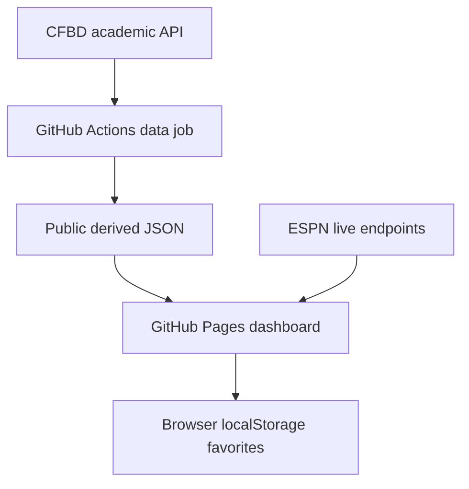

# NCAA Football Dashboard — Agentic Development Guide

## 1. Purpose

Build a polished, responsive NCAA football dashboard hosted on GitHub Pages. The product combines a small near-real-time game-day experience with durable season, historical, and analytics views.

The site must be free to host and operate, require no user accounts, and never expose a private API key in browser code. It should feel like a modern sports application: easy to scan on a phone, rich enough to explore on desktop, and clear about where each metric comes from.

## 2. Non-negotiable constraints

- Deploy as a static GitHub Pages site.
- Use no paid services or paid API tiers.
- Store the CFBD academic API key only as a GitHub Actions repository secret named `CFBD_API_KEY`.
- Never place the key in source code, an `.env` file committed to Git, browser JavaScript, client network requests, generated JSON, screenshots, or logs.
- Use CollegeFootballData (CFBD) as the cached analytics and historical source.
- Use ESPN's public browser-readable endpoints only for the small live-data surface. Treat ESPN as an undocumented, replaceable provider.
- Use GitHub Actions to fetch CFBD data, calculate derived metrics, and publish sanitized JSON files consumed by the static site.
- Do not create accounts, notifications, email, push alerts, paid subscriptions, a database, or a server.
- Favorites must remain browser-only using `localStorage`.

## 3. Product definition

### Target users

College-football fans who want scores, rankings, team context, matchup research, and a concise data-driven view of a season. The product should work well for someone casually checking their favorite team and for someone comparing teams before a game.

### Primary value proposition

The dashboard answers four questions quickly:

1. What is happening in college football right now?
2. Where has each team been ranked over the season?
3. How do two scheduled opponents compare?
4. What do results, form, schedule strength, and game context say beyond a team’s record?

## 4. Data architecture



### CFBD: cached, durable data

CFBD requests run only in GitHub Actions. The workflow requests broad season- or week-level datasets, transforms them into smaller public files, and commits only those public files. Use CFBD for:

- games, schedules, completed scores, records, and matchup history;
- weekly AP/Coaches poll snapshots and rank progression;
- team and player season statistics;
- efficiency/ratings data where included in the academic tier;
- derived team form, schedule-strength, upset, comparison, and recap datasets.

### ESPN: live display data

The browser can request ESPN's college-football scoreboard and an individual game's summary while a relevant page is open. Use it for:

- live/upcoming/final game status;
- score, clock, period, possession, and basic leaders;
- drives, scoring plays, current-drive context, and displayed win probability when present;
- logo/color details when present in a response.

The application must tolerate an ESPN request failing or changing shape. Live widgets should show a non-blocking unavailable/stale state and continue to render cached data.

### Provider abstraction

Create provider modules. UI components must never contain raw ESPN or CFBD URLs.

```text
src/data/
  cfbdStaticRepository.ts     # Reads generated JSON only
  espnLiveProvider.ts         # Isolated live endpoint calls and response mapping
  sportsDataFacade.ts         # Stable app-facing methods
  types.ts                    # Provider-neutral types
```

Examples of facade methods:

```ts
getDashboardSnapshot(season, week)
getRankings(season, week, poll)
getTeamProfile(teamSlug, season)
getTeamSchedule(teamSlug, season)
getMatchup(teamA, teamB, season)
getLiveScoreboard(filters)
getLiveGame(eventId)
```

## 5. Request-budget policy

The CFBD academic tier allows 3,000 requests per month. One request is one endpoint call, not one call per row returned. Prefer a single broad request that returns many team, game, or player records over per-team fetching.

### Target refresh schedule

| Period | CFBD refreshes | Purpose |
|---|---:|---|
| Non-game days | 1 per day | schedules, completed data, rankings, derived metrics |
| Typical game day | 4 per day | refresh data after games complete and stats settle |
| Live display | none from CFBD | ESPN handles browser-side live polling |

Plan around 6–10 CFBD calls per refresh. At that rate, a month with 26 daily refreshes and four four-refresh game days is roughly 420 calls. Reserve the remainder for manual workflow runs, retries, initial imports, and development.

### Query rules

- Fetch season-/week-/classification-wide datasets where the endpoint supports them.
- Do not loop through all teams to collect one statistic per team when a broad endpoint can return the set.
- Do not call CFBD live endpoints; they require paid access.
- Do not call CFBD from the browser.
- Cache raw source snapshots internally in the repository only when they are necessary for reproducibility; publish minimized UI-shaped JSON.
- Skip a commit when generated public files have not changed.

## 6. GitHub Actions specification

### Secret handling

The repository owner manually creates `CFBD_API_KEY` under **Settings → Secrets and variables → Actions**. The workflow receives it only through `process.env.CFBD_API_KEY`. Do not print it, interpolate it into a URL, or write it to disk.

Workflows using the secret must only run from the trusted default branch or through the scheduler/manual dispatch. Do not expose the secret to untrusted fork pull-request workflows.

### Workflow responsibilities

1. Check out the repository.
2. Install the locked Node dependencies.
3. Call the data-refresh script with `CFBD_API_KEY` as an environment variable.
4. Validate every generated JSON file against its schema.
5. Run derived-metric tests.
6. Commit changed files under `public/data/` with a bot-generated message.
7. Let the normal Pages deployment publish the updated static files.

### Suggested workflow schedule

- A daily baseline schedule.
- Additional scheduled windows for Thursday, Friday, and Saturday during the season, using UTC cron expressions documented next to the workflow.
- A `workflow_dispatch` trigger for an owner-run refresh.
- The data script may determine whether games are scheduled and skip unnecessary extra work.

GitHub Actions schedules are best-effort and should not power the live experience. GitHub Actions has a minimum scheduled interval of five minutes; this project intentionally uses much less frequent CFBD refreshes.

### Public data layout

```text
public/data/
  metadata.json
  teams.json
  conferences.json
  seasons/2026/
    games.json
    records.json
    team-stats.json
    player-leaders.json
    rankings.json
    rankings-by-week.json
    derived/
      team-form.json
      schedule-strength.json
      upset-tracker.json
      weekly-recap.json
      playoff-picture.json
```

Every generated document must contain `generatedAt`, `season`, source identifiers, and enough metadata to show the site’s “Last updated” label.

## 7. Information architecture

### Navigation

- Home
- Scores
- Rankings
- Teams
- Matchups
- Playoff Picture
- About Data

On small screens, use a compact bottom navigation or clearly accessible mobile menu. Preserve access to Favorites from the Home page and the Teams page.

### Route model

```text
/
/scores
/rankings
/teams
/teams/:teamSlug
/matchups
/matchups/:teamASlug-vs-:teamBSlug
/game/:eventId
/playoff-picture
/about-data
```

Deep links must work after direct GitHub Pages navigation. Use a GitHub Pages-compatible SPA fallback strategy or build static pages/routes appropriately.

## 8. Features and definitions

### 8.1 Home dashboard

**Purpose:** A high-signal overview of the current college-football day/week.

**Modules, in order:**

1. Favorites: selected teams’ live/upcoming/recent games and rank movement.
2. Live Now: current games, score, game clock, period, possession indicator, and game-status badge.
3. This Week’s Biggest Games: ranked matchups, rivalry games when available, and user-favorite games.
4. Upset Watch: live or completed upset candidates/results.
5. Weekly Recap: largest upset, closest completed game, largest comeback when calculable, highest-scoring game, and ranking movers.
6. Compact Playoff Picture: link into the full view.

**Expected behavior:** Home loads cached content immediately. Live cards start polling only while visible and while the document is visible. A failed live request leaves cached information intact and presents a discreet stale/unavailable label.

### 8.2 Live Scores

**Purpose:** An ESPN-style score board with extensive filtering.

**Filters:**

- all / live / upcoming / final;
- FBS / FCS;
- conference;
- Top 25 involvement;
- favorites only;
- date or week where data is available.

**Score card requirements:**

- away and home logos, names, abbreviations, records, rankings when available;
- score, game state, period/clock, and broadcast if available;
- possession marker for in-progress games;
- Top 25/ranked-game badges;
- click/tap opens Game Center.

**Polling behavior:** Poll only the live scoreboard endpoint every 30 seconds while the Scores page is open and the browser tab is visible. Stop polling while hidden, offline, or after navigating away. Never send requests every 10 seconds by default.

### 8.3 Game Center

**Purpose:** Detail view for one live, upcoming, or completed game.

**Live content:**

- score, clock, quarter, possession, and down/distance when available;
- a simulated horizontal 100-yard field;
- ball marker positioned from the offense’s perspective using the most reliable available yard-line/yards-to-goal value;
- offense/defense identification and team-colored field accents;
- current drive summary, drive result, and recent plays;
- scoring timeline;
- win-probability chart when the provider supplies a valid time series.

**Field rendering rules:**

- Label both end zones with the appropriate teams.
- Make the field visual responsive and accessible; do not encode essential state only in color.
- If possession or yard line is unavailable, show “Drive location unavailable” rather than inferring a location.
- Use a neutral field background; team colors should accent the ball/possession context without making labels unreadable.

**Update behavior:** Poll an individual live-game endpoint every 30 seconds only while this route is open, the game is in progress, and the tab is visible. Stop when final. Animate ball movement subtly but never hide updated text behind animation.

### 8.4 Rankings tracker

**Purpose:** Explore AP, Coaches, and CFP rankings week by week.

**Requirements:**

- poll selector; season selector; week selector;
- Top 25 table with current rank, previous rank, movement, record, conference, and logo;
- new-to-poll and dropped-from-poll indicators;
- rank-history line chart for selected teams; lower rank number is visually better;
- ability to compare 2–5 teams in one ranking-history chart;
- accessible data-table equivalent for charts.

**Definitions:**

- `rank movement = prior available poll rank - current rank`; positive means improved rank.
- A team absent from the prior poll is `new`; a team absent from the current poll after appearing previously is `dropped`.
- CFP rankings are displayed only in the seasons/weeks for which the dataset provides them; do not fabricate a CFP ranking for missing periods.

### 8.5 Team pages

**Purpose:** Give a consistent, data-rich profile for one team.

**Header:** logo, team name, mascot, record, conference, ranking, favorite toggle, and data-update label.

**Tabs/sections:**

- Overview: current record, rank, form, key season metrics, next/recent game.
- Schedule: completed, upcoming, and filterable game list.
- Stats: team season totals/rates and player leaders.
- Rankings: historical rank progression.
- Analysis: schedule strength, team form, ranking-versus-results, and definition notes.

**Dynamic theme:** Use the team’s primary/secondary colors as CSS variables. Apply them to the hero, active tab, chart series, outlines, and emphasis—not to all page surfaces. Calculate readable text color for any themed surface. Fall back to a neutral palette if color metadata is absent or fails contrast requirements.

### 8.6 Favorites

**Purpose:** Personalize the experience without accounts or alerts.

**Behavior:**

- A star/button on score cards and team pages adds/removes a team.
- Save favorite team IDs in `localStorage` using a versioned key, e.g. `ncaa-dashboard:favorites:v1`.
- Validate stored IDs against `teams.json`; silently remove IDs no longer known.
- Prioritize favorites on Home and Scores; provide a Favorites-only filter.
- Never send favorite choices to external services.

### 8.7 Team form

**Definition:** A transparent recent-performance summary, not a predictive rating.

**Baseline calculation:** For each team, use its last five completed games in the selected season. Show W–L record, average point differential, average points scored/allowed, and opponent record/schedule context when available.

**Behavior:**

- Show fewer than five games early in a season and label the sample size.
- Display the actual recent result sequence so users can inspect the summary.
- Never label a team “hot” or “cold” without exposing the underlying definition.

### 8.8 Schedule strength

**Definition:** A transparent descriptive metric, not an official ranking.

**Initial version:** Compute an opponent-quality score from completed opponents’ current winning percentage, excluding the team’s own games from each opponent’s record where practical. Report both completed-schedule strength and remaining-schedule strength separately.

**Rules:**

- Clearly display the formula and update timestamp.
- Do not compare teams with materially different available-game samples without indicating the limitation.
- Keep the implementation modular so stronger rating-based methods can replace it later.

### 8.9 Upset tracker

**Definition:** A game is an upset candidate when an unranked team defeats a ranked team, or when a lower-ranked team defeats a higher-ranked team. The initial version must be rules-based; it must not claim betting-market or model upset probability unless that source is added and explained.

**Requirements:**

- Separate Live Upset Watch from Completed Upsets.
- For completed games, show winner, loser, score, pregame ranks, rank gap, and week.
- For live games, label them as “upset watch,” not a completed upset.
- Support filtering by season, division, conference, and rank-gap threshold.

### 8.10 Ranking versus results

**Purpose:** Identify teams whose polls and performance context tell different stories.

**Initial metric:** Compare rank percentile against a transparent composite of record, schedule-strength percentile, and point-differential percentile. This is an exploratory visualization, not a claim that a team “deserves” a particular rank.

**Requirements:**

- Clearly label inputs, formula version, and limitations.
- Provide a sortable table and a scatter plot.
- Use tooltips/data table to expose the raw values behind each point.
- Avoid absolute or editorial language such as “fraud” or “robbed.”

### 8.11 Playoff picture

**Purpose:** A current-season contextual view, not an official playoff projection.

**Initial contents:**

- current rankings and records;
- conference designation;
- remaining games and remaining schedule strength;
- ranked opponents remaining;
- a “resume context” panel showing record, schedule strength, and recent form.

**Rules:**

- Label all non-official calculations as dashboard analysis.
- Do not assert playoff odds until a defined, tested model exists.
- Treat actual CFP committee rankings as source data, not a prediction.

### 8.12 Matchup Explorer

**Purpose:** Compare teams selected from the current/past schedule.

**Inputs:** Season, scheduled game, or two teams. Prefer actual schedule pairs when available.

**Outputs:**

- team records, rankings, and form;
- side-by-side key stats;
- schedule-strength comparison;
- recent results;
- head-to-head series history when available;
- shared-opponent comparison when reliable;
- link to Game Center for a live/current matchup.

**Visual behavior:** Away team uses the left side, home team the right. Apply team accents locally; retain a neutral center for scores and shared data. Use colors plus labels/icons, never color alone.

### 8.13 Weekly recap

**Purpose:** A dependable weekly summary generated from completed results.

**Cards:**

- biggest completed upset;
- closest final margin;
- highest combined score;
- largest winning margin;
- largest ranking rise/fall once the next poll exists;
- selected notable team/player performance when the source data supports it.

**Rules:** Every card links to the underlying game/team or provides a concise source/data note. If a category cannot be calculated, omit it rather than displaying placeholder facts.

### 8.14 About Data

**Required content:**

- sources: CFBD for generated analytics/historical data; ESPN for live display data;
- source/update timestamps;
- definitions for every derived metric;
- known limitations, coverage gaps, and live-data fallback behavior;
- a statement that ESPN integration is unofficial and replaceable;
- branding/data-use attribution required by the providers’ current terms.

## 9. UI and accessibility standards

- Build mobile-first; test at 320 px, 768 px, and desktop widths.
- Use a dark neutral default visual system; team themes are scoped accents.
- Support keyboard navigation, visible focus states, semantic headings, labeled buttons, and accessible filter controls.
- Meet WCAG AA contrast for text and interactive controls.
- Respect `prefers-reduced-motion`.
- Provide loading skeletons, empty states, error states, and last-updated timestamps.
- Render charts with accessible summaries/data tables.
- Format dates/times in the visitor’s local timezone while preserving the source event time.

## 10. Technical implementation preferences

### Recommended stack

- Vite + React + TypeScript.
- React Router with a GitHub Pages-safe route strategy.
- A lightweight chart library with responsive, accessible fallbacks.
- CSS variables/design tokens for shared theme and team theme support.
- Zod (or equivalent) to validate generated JSON and provider responses.
- Vitest for unit tests; Playwright for critical browser flows if feasible.

### Core domain types

Define provider-neutral TypeScript types for `Team`, `Game`, `LiveGame`, `RankingEntry`, `PollSnapshot`, `TeamForm`, `ScheduleStrength`, `UpsetRecord`, `WeeklyRecap`, `TeamComparison`, and `DataMetadata`.

### No sensitive client code

The frontend must not import the CFBD SDK or read `CFBD_API_KEY`. CFBD access is limited to `scripts/refresh-data/` executed by GitHub Actions.

## 11. Suggested repository structure

```text
.
├── .github/workflows/
│   ├── refresh-data.yml
│   └── deploy-pages.yml
├── public/data/                 # generated, safe-to-publish JSON
├── scripts/refresh-data/
│   ├── index.ts
│   ├── cfbdClient.ts
│   ├── fetchers.ts
│   ├── transforms.ts
│   ├── derivedMetrics.ts
│   ├── validators.ts
│   └── __tests__/
├── src/
│   ├── app/
│   ├── components/
│   ├── pages/
│   ├── data/
│   ├── features/
│   ├── hooks/
│   ├── lib/
│   ├── styles/
│   └── types/
├── docs/
│   ├── data-dictionary.md
│   └── metric-definitions.md
└── README.md
```

## 12. Development phases and acceptance criteria

### Phase 0 — Foundation

- Initialize the TypeScript web app and Pages deployment.
- Create design tokens, routing, error boundary, loading/empty/error components, and mock fixture data.
- Add JSON schemas and a data metadata convention.

**Done when:** the site deploys to GitHub Pages, every target route has a usable mock state, and direct links work.

### Phase 1 — Data pipeline

- Add the secure CFBD GitHub Actions workflow.
- Fetch small broad datasets, validate them, and generate the public data layout.
- Implement test fixtures and no-change commit behavior.

**Done when:** a manual action refresh creates valid public files without exposing the secret; the site displays generated data; a failed source request does not overwrite the last good snapshot.

### Phase 2 — Core browsing

- Build Home, Rankings, Team pages, Favorites, and Matchup Explorer using static generated data.
- Implement team themes and ranking-history visualization.

**Done when:** users can select a team, favorite it, inspect rank history, and compare two scheduled teams without live endpoints.

### Phase 3 — Derived analytics

- Implement and test team form, schedule strength, upset tracking, ranking-versus-results, weekly recap, and the descriptive playoff picture.
- Add formulas and definitions to About Data.

**Done when:** every metric has test coverage, a definition, an update timestamp, and a graceful missing-data state.

### Phase 4 — Live experience

- Add ESPN provider mapping, live Scores, Game Center, 30-second visibility-aware polling, simulated field, drives, and win probability.
- Add clear fallback/stale states.

**Done when:** live data is isolated to one provider module; the app does not poll while hidden; selected-game data stops refreshing at final; static pages remain functional if ESPN is unavailable.

### Phase 5 — Quality pass

- Test mobile layouts, keyboard navigation, contrast, reduced motion, loading/error states, data source labeling, and performance.
- Verify no key appears in the repository, deployed assets, browser bundle, generated data, or Actions logs.

**Done when:** all high-priority flows pass, the repository secret audit is clean, and the site is understandable without prior product context.

## 13. Agent working rules

When implementing this project in a new chat, the coding agent must:

1. Inspect the existing repository before altering files.
2. Preserve existing user changes and avoid destructive Git operations.
3. Create small, reviewable commits only if the user asks for commits.
4. Use mocked fixture data before connecting external providers.
5. Implement provider-neutral types before feature-specific UI.
6. Keep all CFBD logic in the workflow/script layer; do not leak the key.
7. Use broad/batched CFBD requests and keep a request-count log in each refresh run.
8. Add tests for metric calculations and transformations before presenting derived analytics as complete.
9. Make no claim of live reliability or predictive accuracy beyond what the data supports.
10. Verify the build, tests, and relevant route behavior after each meaningful change.
11. Report changed files, verification performed, remaining limitations, and the next recommended implementation step.

## 14. Explicit non-goals for version 1

- Accounts, authentication, cloud database, server backend, or cross-device favorite sync.
- Browser alerts, push notifications, email, or SMS.
- Paid CFBD live endpoints or paid sports data sources.
- Betting recommendations, wagering integration, or odds-based advice.
- Claiming official playoff odds or authoritative rankings beyond published polls.
- Per-play live ingestion from CFBD.

## 15. Initial implementation order

Build in this exact order unless a concrete repository constraint requires a change:

1. Vite/React/TypeScript foundation and deployable Pages shell.
2. Mocked data and visual design system.
3. CFBD-secured refresh script plus generated JSON.
4. Home, Rankings, Teams, Team Page, and Favorites.
5. Matchup Explorer.
6. Derived analytics and About Data definitions.
7. ESPN live scoreboard.
8. Game Center with field/drive view and win probability.
9. Final accessibility, performance, failure-mode, and security review.

